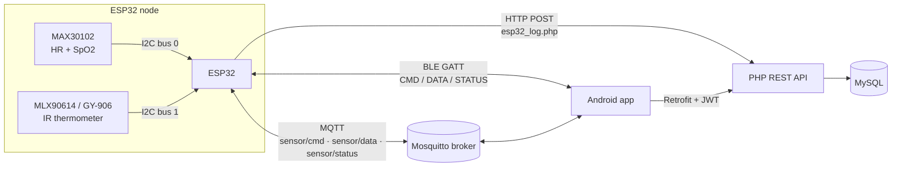

# IoT Health Monitor — Heart Rate, SpO₂ & Body Temperature

End-to-end IoT system that measures **heart rate, SpO₂ and body temperature** on an ESP32, then delivers results to an **Android app** and a **PHP/MySQL REST backend** over **BLE, MQTT and HTTP** at the same time.


---

## Highlights

- **Multi-channel delivery:** one measurement goes out over BLE notify, MQTT publish and HTTP POST, so the data still reaches the server when the phone is out of range, and the app still works when WiFi is down.
- **Duplicate-command protection:** the app can send `START_MEASURE` over BLE and MQTT at once. The firmware uses a measurement lock, a 10 s debounce window and drains the MQTT queue before unlocking, so one tap triggers exactly one measurement.
- **Robust signal processing:** 160 PPG samples are processed with sliding 100-sample windows (Maxim algorithm). Out-of-range values are rejected, then the **median** is taken for HR and SpO₂.
- **Guided measurement flow:** finger detection by IR threshold, forehead detection by object-vs-ambient temperature delta, with live status (`WAITING_FINGER`, `MEASURING_HR`, `MEASURE_DONE`, …) pushed to the app.
- **Multi-user, role-based backend:** JWT auth, admin/guest roles, device registration, per-user measurement history.
- **Medication reminders:** exact alarms that survive reboot (`BootReceiver`), with taken/skipped confirmation synced to the server.
- **Offline-first app:** readings are cached in Room and synced later with WorkManager.

## System architecture



**Measurement sequence**

1. App sends `{"cmd":"START_MEASURE","uid":3}` via BLE write **or** MQTT `sensor/cmd`.
2. ESP32 locks, waits for a finger → measures HR + SpO₂ (~6 s) → waits for forehead → measures temperature (10 readings, averaged).
3. Result JSON is sent over all three channels:
   ```json
   {"devId":"ESP32_H1","rid":"ESP32_H1_1532","hr":78,"spo2":98,"temp":36.6,"ambient":29.4,"userId":3}
   ```
4. The server verifies the device is registered, attributes the reading to the requesting user, and stores it.

## Hardware

| Component | Role | Interface |
|---|---|---|
| ESP32 DevKit | Main controller, WiFi + BLE | — |
| MAX30102 | PPG sensor: heart rate & SpO₂ | I2C0 (SDA 21, SCL 22) @ 400 kHz |
| MLX90614 (GY-906) | Non-contact IR body temperature | I2C1 (SDA 16, SCL 17) @ 100 kHz |

The two sensors run on **separate I2C buses** to avoid clock-speed conflicts (MLX90614 is limited to 100 kHz).

## Repository structure

```
iot-health-monitor/
├── firmware/health_monitor/   # ESP32 firmware (Arduino C++)
│   ├── health_monitor.ino
│   └── config.example.h       # copy → config.h (git-ignored)
├── backend/                   # PHP REST API
│   ├── api/                   # 16 endpoints
│   ├── config.php             # DB connection, CORS, JWT helpers
│   ├── config.local.example.php
│   ├── database/schema.sql    # 7 tables
│   ├── database/seed_admin.sql
│   └── tools/gen_hash.php
├── android-app/               # Android app (Java)
```

## Android app

- **Stack:** Java, single-activity + fragments, ViewPager2, LiveData, Retrofit + OkHttp, Room, Eclipse Paho MQTT, WorkManager, MPAndroidChart
- **User screens:** live dashboard with HR / SpO₂ / temperature gauges, history charts (today / week / month), connection status (BLE, MQTT, HTTP), medication list
- **Admin screens:** user management, device registration, per-user tracking, medication scheduling
- **Background:** foreground `MonitoringService` (health type), exact-alarm medication reminders, `BootReceiver` to restore alarms, `SyncWorker` for offline data

## REST API

| Method | Endpoint | Auth | Description |
|---|---|---|---|
| POST | `/api/login.php` | — | Log in, returns JWT + role |
| POST | `/api/esp32_log.php` | Device ID | ESP32 posts a measurement |
| POST | `/api/sensor_log.php` | JWT | App uploads BLE/MQTT readings |
| GET | `/api/sensor_history.php?range=today&userId=` | JWT | Measurement history for charts |
| GET | `/api/devices_my.php` | JWT | Devices of current user |
| POST | `/api/devices_register.php` | JWT | Register a device |
| GET | `/api/devices_verify.php?deviceId=` | JWT | Check a device exists |
| DELETE | `/api/devices_unregister.php?deviceId=` | Admin | Remove a device |
| GET | `/api/users_list.php` | JWT | List users |
| POST | `/api/users_create.php` | Admin | Create a user |
| DELETE | `/api/users_delete.php?id=` | Admin | Delete a user |
| PUT | `/api/users_changepass.php` | JWT | Change password |
| GET | `/api/medicine_list.php` | JWT | Medication schedule |
| POST | `/api/medicine_save.php` | JWT | Create / update a schedule |
| DELETE | `/api/medicine_delete.php?id=` | Admin | Delete a schedule |
| POST | `/api/medicine_confirm.php` | JWT | Mark a dose as taken / skipped |

## Getting started

### 1. Backend (XAMPP)
```bash
# copy backend/ to htdocs/healthcare/
cp backend/config.local.example.php backend/config.local.php   # fill in DB + JWT secret
mysql -u root < backend/database/schema.sql
php backend/tools/gen_hash.php "your-admin-password"            # paste hash into seed_admin.sql
mysql -u root < backend/database/seed_admin.sql
```

### 2. MQTT broker
Install [Mosquitto](https://mosquitto.org/) and run it on port `1883`.

### 3. Firmware
1. Arduino IDE + ESP32 core. Libraries: `SparkFun MAX3010x`, `Adafruit MLX90614`, `PubSubClient`, `ArduinoJson`.
2. Copy `config.example.h` → `config.h`, fill in WiFi, broker IP and API URL.
3. Flash to the ESP32 and open Serial Monitor at 115200 baud.

### 4. Android app
Open `android-app/` in Android Studio, set the server IP in `AppNetwork.java` (`BASE_URL`, `BROKER`), then build and run.

## Engineering challenges

| Problem | Solution |
|---|---|
| One tap in the app triggered **two measurements** (BLE + MQTT arrived together; MQTT packets queued during the blocking measurement were processed afterwards) | `isMeasuring` lock + 10 s debounce + drain `mqttClient.loop()` for 1.5 s before releasing the lock |
| Noisy, unstable HR/SpO₂ from a single window | Sliding windows over 160 samples, reject invalid values, take the median |
| MAX30102 and MLX90614 conflicting on one I2C bus | Two hardware I2C controllers with independent clock speeds |
| Readings attributed to the wrong user on a shared device | App sends `uid` with the command; server validates it and falls back to the device owner |
| Medication alarms lost after reboot | Exact alarms re-registered in `BootReceiver` and on app start |

## Known limitations & next steps

- HR uses an empirical scale factor (`HR_SCALE = 0.65`) and temperature a fixed offset (`+2.0 °C`). Both need proper calibration against a medical reference device.
- Offline sync can occasionally insert the same reading twice. Planned: server-side dedup using `rid` as a unique key.
- `rid` is based on `millis()`. Add NTP time for globally unique IDs.
- MQTT and HTTP run without TLS or broker authentication. Planned: MQTT over TLS with credentials, HTTPS.
- The measurement routine is blocking. Planned: move to FreeRTOS tasks / ESP-IDF.
- Server IP is hard-coded in the app. Planned: move to `BuildConfig` / settings screen.

## Author

**Khương Văn An** — Electronics & Telecommunications, Phenikaa University
Embedded IoT · ESP32 · Android · PHP/MySQL · [github.com/khuongvanan](https://github.com/khuongvanan)
